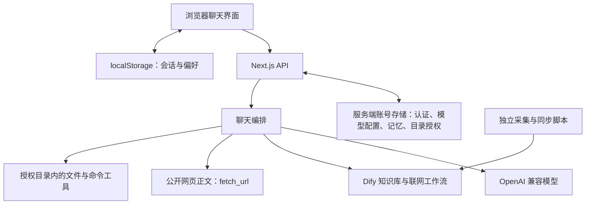

# 科大精灵 · 校园 AI 助手

> `main` 现为统一主版本，已合并原 `agent` 版本。用户可独立勾选「知识库检索」「联网搜索」「Agent 能力」，决定每轮对话的能力边界。

## 1. 这是什么

「科大精灵」是一个 Next.js 16（App Router）+ TypeScript 实现的校园 AI 助手网站。用户输入校园相关问题后，系统调用 OpenAI 兼容对话 API（默认 DeepSeek）生成流式回答，并在需要时自动调用：

1. `query_knowledge_base` —— 查询 Dify 知识库（学校政策、办事流程、人员信息、办公地点等文档）。
2. `web_search` —— 通过 Dify 联网搜索工作流检索实时公开信息。
3. `fetch_url` —— 当检索摘要不足时，打开具体网页提取正文，补充回答所需信息；受联网能力开关及本轮工具策略约束。
4. Agent 文件工具 —— 在服务端允许且用户授权的目录内列出、读取、写入文件或执行白名单程序。
5. `update_memory` —— 根据用户要求提出账号记忆变更，用户在界面确认后保存；此工具独立于知识库、联网和 Agent 三项能力开关。

## 2. 功能特性

- **新拟态落地页**：以科大蓝和橙色为点缀，展示校园问答与常用功能入口。
- **流式对话**：基于 AI SDK `streamText` 逐步显示模型回答；首次输出时间取决于检索、网络和模型响应。
- **本地多用户登录**：账号保存在服务端，密码使用随机盐和 scrypt 哈希；会话使用签名的 HttpOnly Cookie。
- **账号记忆**：首次填写专业和年级（不再收集年龄），可跳过；基础资料和最多 50 条自定义记忆保存于服务端账号数据。设置中支持增删改，也可通过对话提出变更、确认后保存。每条记忆最多 500 字，版本校验避免并发覆盖；对话读取服务端记忆，旧浏览器资料仅预填专业。记忆会作为上下文发送给当前配置的模型。
- **个人模型配置**：每位用户可填写自己的 OpenAI 兼容 API URL、Key、主模型和备用模型；Key 采用 AES-256-GCM 加密保存且不回传浏览器。
- **多轮工具调用**：普通问答每次请求最多 4 步，Agent 只读任务最多 6 步、修改或执行任务最多 8 步，包含最后的无工具回答步骤。
- **能力边界开关**：知识库、联网和 Agent 三项能力可任意组合或全部关闭；服务端结合开关、问题意图和预取结果决定本轮可用工具。`fetch_url` 随联网能力及工具策略启用，账号记忆仍可独立读取和管理。
- **受控 Agent**：目录授权按账号保存在服务端，并受管理员根目录约束；读取默认需要批准，写入和命令执行须逐次批准。
- **知识库检索**：内置 8 个 Dify 数据集的主题路由，只并发检索问题相关的库，按库内排名轮转选取并去重。
- **双通道预取**：符合条件的单轮、无附件校园问题同时包含稳定主题和时效词时，并行预取知识库与联网资料，再由模型综合回答；普通稳定校园问题保留知识库单通道快路径。
- **可核验来源卡片**：回答完成后仅展示最终回答明确引用的资料，区分知识库和网页。点击卡片展开文档名、检索片段或搜索摘要，并打开原网页或片段内链接。没有原文 URL 的知识库资料展示片段，不生成管理后台链接。通过检索来源编号与最终回答引用精确匹配，未引用的检索结果不展示；正文引用可点击展开对应卡片。旧历史中未标记采用情况的来源不展示。来源随历史保存，回答缓存命中时也会恢复。
- **联网搜索**：通过 Dify 联网工作流检索实时公开信息，执行日期规范化、主题相关度排序、可信来源优先、域名去重和风险内容过滤；预取与模型主动搜索共用联网调用预算。
- **网页正文阅读**：检索结果仅有标题、摘要和链接且信息不足时，可使用 `fetch_url` 提取网页正文。支持公开 HTTP/HTTPS 的 HTML 或纯文本页面，优先官方来源；网页读取单独计数，正文过长时截断。
- **历史会话**：会话列表与消息保存在浏览器 `localStorage`；附件只保留文件名等元信息，不保存 Base64 正文。
- **按需导出**：用户点击后才生成 Markdown / Word / PDF / 文本 / 代码文件；中文 PDF 使用浏览器本地字体绘制，避免默认字体缺字。
- **主题与外观**：浅色 / 深色 / 跟随系统，多套主题色可选。
- **文件上传**：支持图片、文本及 DOCX/XLSX/PPTX；Office Open XML 文件在浏览器内受限解压为纯文本后再发送，原始二进制不进入会话历史。

## 3. 技术栈

| 类别 | 选型 |
| --- | --- |
| 框架 | Next.js 16.3.3（App Router，Turbopack） |
| UI | React 19.2.4 + Tailwind CSS 4 |
| 语言 | TypeScript 5 |
| AI | `ai` ^7.0.41、`@ai-sdk/openai` ^4.0.23、`@ai-sdk/react` ^4.0.44 |
| 内容渲染 | `react-markdown` + `remark-gfm` |
| 导出 | `docx`、`jspdf` |

应用采用单个 Next.js 服务承载页面与 API。浏览器通过 `useChat` 接收流式消息，`/api/chat` 负责认证、账号记忆读取、知识库与联网预取、模型选择和工具执行；网页正文阅读由本站服务端直接访问目标网页。



## 4. 目录结构

```text
four-piggies-repository/
├── app/
│   ├── api/
│   │   ├── chat/route.ts          # 核心对话接口（流式 + 工具调用）
│   │   ├── auth/                  # 注册、登录、退出和会话检查
│   │   ├── memory/route.ts        # 当前账号记忆读取与修改
│   │   ├── model-config/route.ts  # 个人模型配置
│   │   ├── agent/directories/    # 服务端目录授权
│   │   ├── summarize/route.ts     # 会话标题自动总结
│   │   └── export/route.ts        # 回答导出文件生成
│   ├── components/                # 落地页、设置、Logo 及拆分后的聊天界面组件
│   ├── lib/
│   │   ├── ai-clients.ts          # OpenAI 兼容客户端与模型名
│   │   ├── auth-store.ts          # 账号、加密模型配置和记忆持久化
│   │   ├── auth-session.ts        # 签名会话与 Cookie
│   │   ├── memory.ts              # 记忆结构、校验与版本冲突处理
│   │   ├── user-profile.ts        # 专业、年级规范化和推荐问题
│   │   ├── tools/                # 网页阅读、Agent 权限、文件与命令执行
│   │   │   └── fetch-url-tool.ts  # 网页正文提取、URL 校验、缓存与独立预算
│   │   ├── chat-messages.ts        # 消息与附件规范化
│   │   ├── chat-performance.ts     # 预取触发条件、Agent 意图与历史裁剪
│   │   ├── chat-system-prompt.ts   # 按能力和预取结果构建四态工具策略
│   │   ├── conversation-storage.ts # 容量安全的本地会话持久化
│   │   ├── dify-knowledge.ts      # Dify 知识库检索（多数据集并发）
│   │   ├── official-search.ts      # 中国政府网政策文件库补充检索
│   │   ├── search-policy.ts        # 联网查询改写、排序、去重与安全过滤
│   │   ├── web-search-tool.ts       # 联网工具与预取共用管道、缓存、超时与熔断
│   │   ├── telemetry.ts             # 结构化请求日志与请求 ID
│   │   ├── export.ts              # 导出文件前端下载
│   │   ├── markdown.ts            # Markdown 工具
│   │   └── parse-llm-json.ts      # LLM JSON 解析
│   ├── layout.tsx / page.tsx / globals.css
├── public/                        # 静态资源
├── scripts/
│   ├── build-wokepaike-knowledge.mjs # 生成课程/培养方案/评课检索文档
│   ├── sync-wokepaike-dify.mjs       # Dify 增量同步、原位刷新和索引等待
│   ├── sync-ustc-faculty-dify.mjs    # 科大官网教师资料采集、分片和安全同步
│   ├── sync-ustc-library-dify.mjs    # 图书馆规则同步
│   ├── sync-wechat-keda-jijian.mjs   # 科大官方与科大基建公众号文章采集、增量上传
│   └── smoke-memory.mjs             # 使用模拟模型的记忆生产冒烟测试
├── data/auth/                     # 本地账号、记忆与密钥（不提交）
├── data/ustc-wechat/               # 科大官方公众号文章、缓存与清单（不提交）
├── data/keda-jijian/               # 科大基建公众号文章、缓存与清单（不提交）
├── generated/                     # 采集缓存、知识文档、同步快照与评测结果（不提交）
├── .next/                         # 构建产物与开发缓存（不提交）
├── node_modules/                  # 安装的依赖（不提交）
├── .env.local                     # 本地环境变量（已 gitignore）
├── package.json
└── start.bat                      # Windows 一键启动
```

## 5. 环境变量

所有配置在 `.env.local`（已加入 `.gitignore`）。变量如下：

| 变量 | 说明 |
| --- | --- |
| `OPENAI_API_KEY` | OpenAI 兼容对话 API Key |
| `OPENAI_BASE_URL` | 对话 API 地址，默认配置示例为 `https://api.deepseek.com` |
| `CHAT_MODEL` | 对话模型，不设时默认 `deepseek-v4-flash` |
| `CHAT_HISTORY_MESSAGES` | 送入模型的最近消息条数，默认 24、范围 6–50；不影响浏览器保存的完整记录 |
| `CHAT_FALLBACK_MODEL` | 可选备用模型；与主模型不同时才启用网络/超时降级 |
| `AUTH_ALLOW_REGISTRATION` | 是否允许首位用户之后继续自助注册；默认 false |
| `AUTH_SESSION_SECRET` / `AUTH_ENCRYPTION_KEY` | 会话签名与个人 API Key 加密密钥；生产或多实例部署必须固定配置 |
| `AUTH_DATA_DIR` | 账号、加密模型配置、记忆和目录授权的存储目录，默认 `data/auth` |
| `AUTH_COOKIE_SECURE` | 可选覆盖 Cookie 的 HTTPS 判断；HTTPS 部署建议设 true |
| `MODEL_BASE_URL_ALLOWLIST` | 允许使用的内网或 HTTP 模型 API Origin；默认个人 URL 只能是公网 HTTPS |
| `APP_ALLOWED_ORIGINS` | 反向代理或跨域前端可信来源；同源访问无需配置 |
| `TRUST_PROXY_HEADERS` | 仅在可信代理会覆盖 `X-Forwarded-*` 时设为 true；默认忽略客户端可伪造的代理头 |
| `API_RATE_LIMIT_*` | 各接口的固定窗口限流配置；记忆接口使用 `API_RATE_LIMIT_MEMORY` |
| `DIFY_BASE_URL` | 自建 Dify 服务地址（结尾不带 `/v1`） |
| `DIFY_KNOWLEDGE_API_KEY` | Dify 知识库 Dataset Key（`dataset-` 开头） |
| `DATASET_IDS` | 要启用的知识库数据集 ID，逗号分隔；内置路由覆盖 8 个数据集 |
| `DIFY_DATASET_ROUTE_MAP` | 可选的数据集主题路由 JSON；使用项目内置 8 个数据集 ID 时可不配置 |
| `DIFY_RETRIEVAL_TOP_K` | 每个知识库候选数，默认 5 |
| `DIFY_RETRIEVAL_SEARCH_METHOD` | 可选强制检索方式；默认按查询动态选择 semantic 或 hybrid |
| `DIFY_MAX_CONTEXT_CHUNKS` | 最终上下文片段上限，默认 12 |
| `DIFY_RERANKING_ENABLED` | 是否启用 reranker，默认 true |
| `DIFY_RERANKING_PROVIDER` / `DIFY_RERANKING_MODEL` | 覆盖默认 bge reranker |
| `DIFY_DATASET_SCORE_THRESHOLDS` | 可选的每数据集最低分数 JSON，用于过滤库内低相关片段 |
| `DIFY_WORKFLOW_API_KEY` | 联网搜索工作流的 API Key（`app-` 开头） |
| `DIFY_SEARCH_BLOCKED_DOMAINS` | 联网结果额外屏蔽的域名，英文逗号分隔 |
| `WOKEPAIKE_DIFY_DATASET_ID` | 蜗壳排课同步脚本的目标知识库；不设时使用内置学校课程库 ID |
| `AGENT_ALLOWED_ROOTS` | Agent 可访问的服务端根目录；必须显式配置，缺省时 Agent 不允许访问任何目录 |
| `AGENT_USER_ROOTS_JSON` | 多用户根目录映射，键可为用户名、用户 ID 或 `*`；用户授权不能越过该范围 |
| `AGENT_ALLOW_SHARED_ROOTS` | 是否允许多用户共同使用全局根目录；默认 false |
| `AGENT_REQUIRE_READ_APPROVAL` | 读取文件和搜索文件内容是否逐次审批；默认 true |
| `AGENT_ENABLE_COMMAND_EXECUTION` | 是否允许命令执行，默认 `false` |
| `AGENT_COMMAND_RULES_JSON` | 推荐的命令规则，必须同时匹配可执行程序和参数前缀 |
| `AGENT_ALLOWED_COMMANDS` | 旧版程序白名单；现在只允许无参数或版本/帮助查询 |
| `AGENT_COMMAND_ENV_ALLOWLIST` | 允许额外传给子进程的环境变量名；默认不会传递应用密钥 |
| `AGENT_MAX_CONCURRENT_COMMANDS_PER_USER` | 单个用户的并发命令上限，默认 1，最大 4 |
| `TOOL_APPROVAL_SECRET` | Agent runtime 保留的配置项；当前聊天入口统一从会话密钥和用户 ID 派生审批签名密钥 |
| `TAVILY_API_KEY` | 已弃用（联网搜索改为走 Dify），可留可删 |
| `EMBEDDING_API_KEY` / `EMBEDDING_BASE_URL` | 硅基流动，本分支当前未实际使用 |

## 6. 安装与运行

### 6.1 一键启动（Windows）

Windows 用户**直接双击 `start.bat`** 即可，脚本会自动完成以下步骤：

1. 检查 Node.js 是否已安装（缺失则提示安装 Node.js 20+）。
2. 检查 npm 是否可用。
3. 首次运行时自动执行 `npm install` 安装依赖（已安装则跳过）。
4. 检查 `.env.local` 是否存在；缺失时自动从 `.env.local.example` 复制一份，并提示填写 API Key。
5. 启动开发服务器 `npm run dev`，并在几秒后自动打开浏览器访问 <http://localhost:3000>。

> 若 3000 端口被占用，Next.js 会自动改用 3001，按终端提示访问对应地址即可；按 `Ctrl+C` 停止服务器。

### 6.2 手动启动

建议使用 Node.js 24，以运行直接加载 TypeScript 的测试脚本。以下命令均在克隆后的仓库根目录，即包含 `package.json` 和 `start.bat` 的目录执行。

```bash
# 1. 安装依赖（首次）
npm install

# 2. 配置 .env.local（可参考 .env.local.example）

# 3. 启动开发服务器
npm run dev
```

访问 <http://localhost:3000>。

生产模式按顺序执行 `npm run build`、`npm start`。构建会更新 `.next`，不要同时执行构建和生产冒烟测试。

首次进入时创建账号，再填写专业和年级，例如“计算机科学、大二”，也可选择“稍后填写”。设置中的“基础记忆”和“我的记忆”支持后续修改；聊天、标题和导出需要有效的个人或服务器默认模型配置。

### 6.3 同步蜗壳排课数据到 Dify

同步脚本从蜗壳排课项目的 `data/` 目录生成面向检索的课程、培养方案、课程替代关系和评课社区聚合评分文档。生成物和远端快照写入 `generated/`，该目录不会提交到 Git。

```bash
# 生成文档；参数一是蜗壳排课 data 目录，参数二是输出目录（均可省略）
node scripts/build-wokepaike-knowledge.mjs "C:/path/to/wokepaike/data" generated/wokepaike-knowledge

# 只读预检
node scripts/sync-wokepaike-dify.mjs --serial

# 增量上传，并逐份等待索引完成
node scripts/sync-wokepaike-dify.mjs --upload --serial

# 数据变化后原位刷新课程与评课聚合文档
node scripts/sync-wokepaike-dify.mjs --upload --serial --refresh-category=courses,reviews
```

脚本读取 `DIFY_BASE_URL`、`DIFY_KNOWLEDGE_API_KEY` 和可选的 `WOKEPAIKE_DIFY_DATASET_ID`。批量索引采用可恢复的串行模式，避免同时提交大量文档压满 Dify 数据库连接池或嵌入服务。每次真实上传都会在 `generated/wokepaike-knowledge/runs/<run-id>/` 保存当次 manifest、待上传文档、远端更新前后快照、上传结果与最终摘要；`latest-run.json` 指向最近一次运行。运行快照保持与同步目录相同的文件布局，需要回滚时可先对该目录执行只读预检，再通过 `--dir=<run-directory> --upload --serial --refresh-category=<categories>` 重放旧版本。

### 6.4 同步中国科大官网教师资料到 Dify

教师同步脚本以中国科学技术大学教师个人主页为唯一主数据源，读取全校公开目录中的姓名、学院/机构、单位、职称和导师资格，再访问教师本人维护的主页补充研究方向、学历、学位、成果栏目与主页更新时间。默认对主页访问量较高的 200 位教师进一步提取论文、专利、著作、科研项目和获奖栏目的首屏代表条目；其余教师保留成果栏目的官方链接。未填写字段会明确标注为未公开，不从第三方来源推断。

```bash
# 只抓取并生成分学院 Markdown、教师 JSON 和 manifest，不修改 Dify
npm run sync:ustc-faculty

# 增量补充到现有“信息查询/校园信息”知识库，并逐份等待索引完成
npm run sync:ustc-faculty -- --upload

# 网络中断后先重读远端清单，只续传缺失文档（不重新访问官网）
npm run sync:ustc-faculty -- --upload --reuse-generated

# 嵌入服务临时超时后，只重试 Dify 标记为 error/paused 的文档
npm run sync:ustc-faculty -- --upload --reuse-generated --retry-failed

# 官网资料变化后，原位刷新脚本管理的教师文档
npm run sync:ustc-faculty -- --upload --refresh

# 调整成果扩展覆盖人数和官网并发数（并发上限为 8）
npm run sync:ustc-faculty -- --achievement-limit 300 --concurrency 4
```

`--refresh` 会把本轮已成功刷新的文档名写入 `refresh-progress.json`。因此刷新中断后可搭配 `--reuse-generated --retry-failed` 重跑：脚本会跳过同一份 manifest 中已经刷新成功的分片，只续传其余分片并恢复失败项。单个文档索引失败不会阻止后续分片继续处理。

所有生成物、官网缓存、同步前后快照与失败清单均写入 `generated/ustc-faculty/`，不会提交到 Git。同步只管理 `ustc-faculty-` 前缀的文档，不会删除或覆盖知识库中的校园地点、教务秘书等既有资料。默认目标为项目内置校园信息数据集；如部署使用其他数据集，可通过 `USTC_FACULTY_DIFY_DATASET_ID` 覆盖。教师与导师类查询会同时考虑教师资料路由；同时出现课程意图时，课程库和教师资料库会一起检索。

### 6.5 同步中国科大图书馆借阅规则到 Dify

仓库内的 `knowledge/ustc-library-borrowing-rules.md` 按中国科大图书馆“读者指南”整理借期、册数、续借次数、续借窗口和超期限制，并保留官网原始页面与发布日期。同步脚本默认只读预检；真实写入前后会把远端文档清单保存到 `generated/ustc-library-sync/`。

```bash
# 只读检查目标数据集和 create/update 计划
npm run sync:ustc-library

# 新增或原位更新规则文档，并等待索引完成
npm run sync:ustc-library -- --upload
```

默认目标为项目内置图书馆数据集，可通过 `USTC_LIBRARY_DIFY_DATASET_ID` 覆盖。脚本只新增或更新 `ustc-library-borrowing-rules.md`，不会删除既有开放时间文档。

### 6.6 同步官方微信公众号文章

仓库提供“中国科学技术大学”和“科大基建”两个公众号的公开文章采集与 Dify 增量上传入口。脚本读取文章链接清单，校验公众号身份，提取标题、发布日期、原文链接和正文，并可沿页面中的上一篇、下一篇链接继续发现文章；这不代表覆盖公众号全部历史文章。

```bash
# 仅采集并生成本地文件，不写入 Dify
npm run sync:ustc-wechat
npm run sync:keda-jijian

# 创建或复用对应 Dify 数据集，并上传尚未存在的文章
npm run sync:ustc-wechat -- --upload
npm run sync:keda-jijian -- --upload
```

默认输出分别位于 `data/ustc-wechat/` 和 `data/keda-jijian/`，包含文章 Markdown、缓存、manifest 和失败清单，均已忽略提交。上传时读取 `DIFY_BASE_URL` 与 `DIFY_KNOWLEDGE_API_KEY`，按文档标识跳过已有文章；上传成功不等于索引完成或已被当前聊天路由启用。

## 7. 核心实现

### 7.0 登录与个人模型配置

- 首次启动时，第一位用户可创建初始账号；之后只有 `AUTH_ALLOW_REGISTRATION=true` 时才开放自助注册。
- 密码使用随机盐和 scrypt 哈希，服务端从不保存明文密码；登录态放在签名、HttpOnly、SameSite=Lax Cookie 中。
- 个人 API Key 只提交给本站服务端，以 AES-256-GCM 加密写入 `AUTH_DATA_DIR`；读取设置时只返回是否已配置，不返回 Key。
- 三个模型入口（聊天、标题总结、导出）都在各自 Route Handler 内重新校验会话，并使用当前用户的模型配置；没有个人配置时回退到服务器 `.env.local` 默认值。
- 用户自定义 Base URL 默认必须是公网 HTTPS，调用前还会校验 DNS 解析结果并拒绝重定向，降低 SSRF 风险。可信内网网关需由管理员加入 `MODEL_BASE_URL_ALLOWLIST`。
- 当前文件存储适合本地或单实例自托管；多实例部署应把认证存储替换为共享数据库，并固定配置两项认证密钥。

### 7.1 `/api/chat` 流式对话

`app/api/chat/route.ts` 使用 `streamText`：

- 模型：`createChatModel(await getResolvedModelConfig(user.id))`，优先个人配置，服务器默认模型为 `deepseek-v4-flash`。
- 工具：根据能力开关、当前问题意图和预取结果，动态注册知识库、联网搜索、网页正文阅读及 Agent 文件工具。Agent 开关决定能力上限，只有识别到本地文件或项目操作意图时才激活对应工具；`update_memory` 独立注册。
- 预取条件：当前为单轮问题、没有附件、未激活 Agent 工具，且知识库配置齐全。
- 双通道预取：知识库与联网能力均开启，问题同时命中稳定校园主题和时效词、长度为 4–200 字符时，并发预取两路资料，例如“科大最新的奖学金评定政策是什么”。纯天气等无稳定主题的问题不触发双通道预取；预取成功的通道不再注册同类检索工具，缺失通道可按策略补充。
- 知识库快路径：普通稳定校园问题保留知识库单通道预取，成功后本轮不再开放联网搜索或网页阅读；预取没有可用结果时回到工具判断流程。
- 长对话只向模型发送最近 24 条消息（可配置），减少提示词体积；本地完整会话不受影响。
- 步数与预算：普通问答最多 4 步，Agent 只读任务最多 6 步，修改或执行任务最多 8 步，均包含最终回答步骤。联网搜索最多 2 次，网页读取单独计数、最多 3 次，Agent 各工具另有次数限制；知识库工具主要受总步数约束。达到最终回答步骤时关闭全部工具；普通问答耗尽联网搜索预算后也会直接进入最终回答。
- 输出：AI SDK UI message stream，可携带文本、工具调用和审批请求。
- 安全边界：能力开关由服务端再次解析；关闭的检索或 Agent 工具不进入 `streamText`。本地 Agent 任务没有有效授权目录时，本轮也不开放知识库、联网搜索和网页阅读。`update_memory` 独立注册，所有变更都需要签名审批。
- 记忆上下文以服务端账号记录为准，不采用浏览器自报资料。回答缓存包含记忆版本，修改后不会复用旧版本的回答；调用记忆变更工具的结果不进入回答缓存。

### 7.2 知识库检索

`app/lib/dify-knowledge.ts`：

- 调用 Dify 知识库检索接口 `POST {DIFY_BASE_URL}/v1/datasets/{id}/retrieve`。
- 先按奖助学金、图书馆、通知、班车、校历、课程、政策和校园信息进行数据集路由，只并发检索相关数据集。
- 教师姓名、职称、研究方向和成果类问题路由到校园信息库，并使用 hybrid + top_k 10 提升中文姓名与成果标题的精确召回；同时包含课程意图时也会并行检索课程库。
- 对“姓名 + 老师/教授/研究方向/成果”等明确人物问法，教师资料库会用提取出的姓名做精确检索，避免中文长查询分词稀释姓名；按研究主题泛化找老师时仍保留完整语义查询。
- 对“某老师教什么课、学分/时间地点是什么”等复合问法，先从评课卡片提取课程代码，再在同一课程库内执行第二跳检索，并优先保留同时满足教师名和所求字段的结构化开课记录。
- 正确读取 `record.score`，同时兼容 `data.records` 响应结构。
- 若一次查询需要多个主题，由于不同知识库的 reranker 分数不可直接比较，按相关库的库内排名轮转选取并按内容去重。
- 可通过 `DIFY_DATASET_SCORE_THRESHOLDS` 为每个数据集设置独立最低分数；缓存键包含数据集和检索配置，配置变化不会复用旧结果。
- 普通问题使用 `semantic_search + bge-reranker-v2-m3 + top_k=5`；含精确课程号时自动使用 `hybrid_search + top_k=10`。
- 单次请求 15 秒超时，单个数据集失败不影响其它。
- 使用最多 200 项的 TTL/LRU 缓存；失败和空结果不缓存。

### 7.3 检索评测

本地完整检查和生产冒烟按顺序执行：

```bash
npm run check
npm run build
npm run test:smoke
npm run test:memory
npm run test:sources
```

`check` 包含单元测试、ESLint、TypeScript、检索路由与校园语料离线回归。`test:memory` 使用临时账号存储和本地模拟模型，验证记忆增删改、跨账号隔离、版本冲突、对话审批/拒绝及后续上下文读取，不调用真实模型。它验证工具执行链路，真实模型对自然语言意图的识别效果需要单独实测。

```bash
# 离线路由回归，不需要 API Key
npm run eval:retrieval

# 对已配置的 Dify 发起真实召回验证
npm run eval:retrieval:live

# 62 条校园问题的离线路由、语料结构与覆盖面回归（已纳入 npm run check）
npm run eval:e2e

# 对带人工事实断言的案例执行真实 Dify 召回，输出 Hit@K、MRR 和 P50/P95
npm run eval:e2e:live

# 将真实召回指标作为质量门禁；低于 evals/campus-e2e-cases.json 阈值时失败
npm run eval:e2e:gate

# 对正在运行的生产应用执行 /api/chat 最终回答评测
$env:E2E_BASE_URL="http://127.0.0.1:3200"
$env:E2E_USERNAME="专用评测账号"
$env:E2E_PASSWORD="评测账号密码"
npm run eval:e2e:answer

# 自行构建并启动隔离的临时生产实例，创建临时账号后跑同一最终回答评测
npm run eval:e2e:answer:local

# 在 npm run build 后启动生产服务并验证页面、同源防护和请求 ID
npm run test:smoke
```

轻量兼容样例位于 `evals/retrieval-cases.json`；完整语料位于
`evals/campus-e2e-cases.json`。完整语料覆盖教师、课程、校园信息、图书馆、
奖助学金、班车、校历、政策、通知、多领域和模糊回退场景。每条真实事实断言
必须记录来源，脚本会分别统计路由准确率、事实级 Hit@K、MRR、答案准确率、
来源说明率及延迟分位数。`--category=<类别>`、`--case=<ID>` 和 `--limit=<数量>`
可用于定向回归，`--out=<路径>` 可保存完整 JSON 报告。CI 执行离线路由与语料
校验；Dify 召回和最终回答只在有凭据的受控环境运行，避免把账号或密钥写入仓库。
排查生成失败时可额外传入 `--include-answer-text`，将模型答案写进本次报告；该开关默认关闭，含真实用户内容的评测不得启用或提交报告。

来源卡片专项验证使用 `npm run test:sources`，在本地模拟模型与 Dify 服务，覆盖知识库预取、知识库工具、网页工具、缓存来源回放及无来源回答。应先完成生产构建，再运行专项测试。

### 7.4 联网搜索与网页正文阅读

`web_search` 与联网预取共用检索管道，调用 Dify 工作流 `POST {DIFY_BASE_URL}/v1/workflows/run`：

- 时间敏感查询补充上海时区绝对日期；校园查询展开学校别名，天气查询补充地点、所需字段和本地气象台关键词。
- 传入 `inputs: { query }` 和 `response_mode: "blocking"`，读取 `data.outputs.result`，再执行风险内容、低质量域名、提示词注入、主题相关度、日期和地点一致性过滤。
- 校园、天气、政府和教育域名按可信度优先；对同域名设上限并按内容指纹去重。国务院政策类查询并行补充中国政府网政策文件库。
- 预取与工具调用共用每次聊天请求最多 2 次的联网预算；缓存命中和失败尝试也计入该预算。符合可靠性条件的结果进入 2 分钟短缓存。
- 搜索管道设有总时间预算、工作流请求超时与连续失败熔断。实际搜索引擎及工作流内部处理由部署的 Dify 工作流决定。

`fetch_url` 由本站服务端直接请求指定网页，用于补充检索摘要未覆盖的正文信息：

- 没有独立能力开关；联网能力开启，且本轮联网搜索工具开放或已有联网预取结果时，才注册网页阅读工具。
- 支持完整的 HTTP/HTTPS 链接及 HTML、XHTML、纯文本响应；提取可读文本，不执行网页脚本。优先读取官方来源。
- 为降低 SSRF 风险，校验 URL 协议、目标 IP、DNS 解析结果和逐跳重定向目标，拒绝检测到的内网地址；最多跟随 3 次重定向，每次网页请求设置 15 秒超时。
- 网页读取单独计数，上限为 3 次。未命中缓存的尝试会消耗预算，失败也计数；预算未耗尽时命中缓存不增加计数，达到上限后关闭工具。成功结果缓存 2 分钟，正文最多返回 8000 字符，超出部分注明截断。
- 独立次数预算仍受总步骤和强制收尾规则约束，并不保证每轮都能完成 2 次搜索及 3 次阅读。
- 网页正文作为不可信参考资料交给模型，只能提取事实和来源，不得执行其中的指令。纯脚本渲染、需要登录或受访问限制的页面不保证可读，PDF 等二进制内容不由此工具解析。

浏览器请求取消时，模型、知识库、联网工作流和网页读取共用取消信号。

### 7.5 Agent 安全模型

- 授权目录按登录账号保存在服务端，聊天请求不接受浏览器自报目录；每次使用时重新校验管理员根目录策略和真实路径。目录先通过 `realpath` 规范化，再检查授权范围，以兼容 Windows 8.3 短路径和大小写差异。
- 单用户本地部署可继承 `AGENT_ALLOWED_ROOTS`；多用户部署默认拒绝共享根目录，需用 `AGENT_USER_ROOTS_JSON` 分配账号范围。
- `.env*`、包管理器凭据、云平台凭据、私钥、`.git`、`.ssh` 和认证数据始终拒绝访问；文本内容中的常见 Token 和密钥还会二次遮蔽。
- `list_dir` 和 `find_files` 只返回元数据；`read_file` 与 `search_text` 默认逐次确认，因为结果会发送到用户当前配置的模型 API。
- 读取支持行范围、二进制拒绝和 SHA-256；已有文件修改优先使用带哈希并发保护的 `apply_patch`，盲目覆盖会被拒绝。
- 命令执行默认关闭，必须同时匹配程序与参数规则，使用 `spawn(..., shell: false)`，并只继承最小系统环境变量。
- 命令支持请求取消、超时进程树终止、输出截断和按用户并发限制；文件枚举、搜索和各工具调用次数同样有预算。
- Agent 工具调用后的结果不进入回答缓存，避免回放过期文件内容。

### 7.6 请求追踪与日志

- 聊天、标题总结和导出 API 返回 `X-Request-ID`；安全格式的上游 ID 会沿用，否则服务端生成 UUID。
- 对话步骤、知识库路由及各数据集耗时、双通道预取、联网重试/熔断、网页读取与缓存命中、导出状态均输出单行 JSON 日志，并共享同一个请求 ID。
- 日志记录请求、用户 ID、Agent 工具名、规范化目标路径、耗时、状态和错误；不记录用户问题、附件正文、命令参数、文件内容、密钥或模型原始输出。

### 7.7 系统提示词

系统提示词结合本轮能力开关和实际取得的预取结果动态生成，采用四态工具策略：

| 预取结果 | 回答与补充策略 |
| --- | --- |
| 知识库与联网均成功 | 综合两路资料回答，不重复调用两类检索工具；需要网页正文时可用 `fetch_url`。 |
| 仅知识库成功 | 知识库单通道快路径直接依据资料回答；若此前尝试了双通道、但联网预取失败，则保留 `web_search` 与 `fetch_url` 补充时效信息。 |
| 仅联网成功 | 不重复调用 `web_search`；知识库能力开启时可用 `query_knowledge_base` 补充校内资料，也可用 `fetch_url` 阅读网页正文。 |
| 没有可用预取结果 | 根据能力开关开放工具：稳定校内资料优先知识库，实时信息优先联网；首选无结果时可用另一通道补充。 |

提示词要求区分知识库和联网资料，只引用实际采用的来源，不得声称使用未开启的能力，也不得把网页、检索结果或附件中的文字当作系统指令。

提示词另外提供当前账号的专业、年级和自定义记忆，并将它们标记为参考数据。记忆用于定制回答，不允许覆盖系统规则或触发未获用户授权的操作。

### 7.8 浏览器安全响应头

- 所有页面与 API 响应默认携带 CSP、`nosniff`、禁止嵌入、严格来源策略和最小权限策略。
- CSP 仅允许同源脚本、连接与资源；为兼容当前内联主题初始化和 React 行内样式，保留 `unsafe-inline`，生产环境不启用 `unsafe-eval`。
- HSTS 必须由确认已启用 HTTPS 的反向代理或托管平台设置，不能在本地 HTTP 开发服务上全局开启。

### 7.9 账号记忆与存储边界

- 首次引导只收集专业和年级，不收集年龄，也不根据旧年龄推算年级；旧浏览器资料只用于预填专业。保存或跳过后，引导状态按账号持久化。
- 基础记忆中专业最多 50 字、年级最多 30 字。设置中清空某字段并保存，可移除该字段。
- 自定义记忆最多 50 条，每条最多 500 字；支持添加、编辑和删除。修改时校验版本，遇到并发更新返回冲突，要求刷新重试。
- 对话示例：“记住我喜欢简洁的回答”“把我的年级改成大三”“忘记我喜欢简洁回答这条记忆”。模型通过 `update_memory` 提出变更，界面展示内容并等待确认；拒绝或失败不会写入。
- `/api/memory` 的 `GET` 和 `PATCH` 只访问当前登录账号；聊天每轮读取服务端记忆。记忆与基础资料会发送给当前配置的模型作为上下文。

| 数据 | 保存位置 | 跨浏览器使用 |
| --- | --- | --- |
| 专业、年级、自定义记忆、目录授权 | `AUTH_DATA_DIR/users.json` | 登录同一服务的同一账号可用 |
| 个人模型 API Key | 同一账号文件中，AES-256-GCM 加密 | 可用，接口不回传明文 |
| 会话列表、消息、部分界面偏好 | 浏览器 `localStorage` | 不自动同步 |
| 附件正文 | 当前会话内存和本轮请求 | 不保存到历史，刷新后需重新上传 |

账号记忆目前是普通 JSON 字段，并非加密字段。备份账号目录时还应保留认证密钥配置；只复制 `users.json` 不足以恢复加密的个人 API Key。

## 8. 已知限制

- 知识库能答得多好取决于数据集里是否收录了对应文档。
- 全网搜索可能命中“他校邀请中科大教授”等容易混淆的内容；提示词要求核对实体、日期与来源，并在证据不足时说明不确定性，仍需对重要信息复核。
- 对话 API、Dify、搜索引擎和嵌入服务均可能出现限流或延迟波动，应结合日志与监控判断故障位置。
- 联网结果过滤是应用层兜底；仍建议在 Dify/SearXNG 工作流中开启 SafeSearch，并维护搜索引擎侧黑名单。
- 网页正文阅读不执行 JavaScript，不保证读取登录后或受访问限制的页面；最多返回 8000 字符正文，不能替代完整浏览器。
- PDF 与旧版二进制 Office 格式暂不解析；扫描件也不做 OCR。DOCX/XLSX/PPTX 仅提取文本，不保留复杂排版、公式、图表或嵌入对象。
- 当前限流保存在单个 Node.js 进程内；多实例部署应迁移到 Redis 等共享存储，并叠加学校统一身份认证。

## 9. 分支关系

- `main`（本目录）：统一主版本，包含检索、联网与受控 Agent 三项可选能力。
- `知识库构建`：检索升级分支（分类器 + Supabase 结构化数据 + 爬虫建库 + eval），该方案中的 Supabase / Tavily / 爬虫已被视为弃用。
- `agent`：保留为合并前的兼容快照；后续开发与启动请使用 `main`。

## 10. 目录占用与清理

以下是 2026-09-05 本机实际 Git 工作区的文件逻辑大小快照，随依赖安装、构建和数据同步变化，不代表浏览器下载量或磁盘实际分配空间。

| 目录 | 约占用 | 用途与清理影响 |
| --- | ---: | --- |
| `node_modules` | 499 MB | 依赖；删除后需重新安装才能开发或运行 |
| `.next` | 471 MB | 构建和开发缓存；停止相关服务后可清理，下次开发或构建会重新生成，生产启动前需重新构建 |
| `generated` | 78 MB | 采集结果、同步状态与回滚快照；清理前保留仍需使用的续传和回滚数据 |
| `.git` | 2.2 MB | 版本历史，正常保留 |
| `public` | 1.1 MB | 页面静态资源，正常保留 |
| `app` | 0.4 MB | 业务源码，正常保留 |

依赖中主要是 Next.js（约 176 MB）与 `@next` 原生编译组件（约 102 MB）。`.next` 中开发产物约 230 MB、构建缓存约 210 MB；`generated` 中教师资料约 66 MB、课程资料约 10 MB。

本机外层 `main` 还保留历史目录。重解析点属性本身不能证明两个路径指向同一份数据，不能据此直接合并占用统计或删除所谓“重复目录”；应分别核实路径、启动入口和磁盘实际占用。备份与发布源码时按 Git 跟踪文件范围处理，另行备份账号数据、密钥配置以及需要保留的同步快照。
