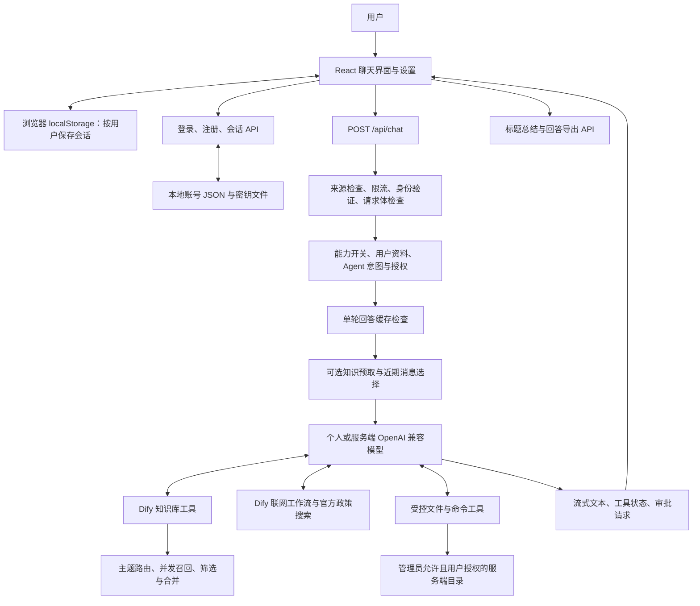

# 科大精灵：项目架构、优缺点与改进路线评估

评估日期：2026 年 9 月 5 日

评估对象：`C:\Users\hlqa0\Desktop\107lab\main\.codex-github-sync` 当前工作区

Git 基线：`5490536`（当前工作区另有大量未提交修改和新增文件）

方法：核心代码阅读、配置与脚本检查、单元测试、离线路由评测、生产构建。

## 1. 总体评价

**科大精灵已经超出简单的“聊天页面接一个模型 API”，形成了以校园知识检索为核心、兼具联网查询和受控本地文件操作的应用。它适合继续作为本地个人助手和小范围校园工具迭代；当前证据不足以把它评价为已经验证过的大规模校园服务。**

项目最有价值的部分，是针对校园信息特点做了实际工程处理：按主题选择知识库、避免跨库分数直接比较、对课程和教师查询做专门召回、限制无休止的工具调用，并为本地 Agent 加入目录权限、审批、输出限制和写入前哈希检查。这些都直接服务于可用性。

主要短板集中在三个方面：第一，检索路由正确并不代表资料完整、最新或答案正确，目前常规检查对真实回答质量的约束仍有限；第二，性能捷径有时会减少补充证据的机会；第三，新增账号与个人配置功能后，缓存、持久化、会话撤销和部署模型还需要进一步统一。

建议优先完善“能找到证据、准确回答、失败时说明原因、历史可靠保存”的主链路，再扩展 Agent 的复杂任务和更多外观功能。

### 按使用场景判断成熟度

| 场景 | 评价 | 主要原因 |
| --- | --- | --- |
| 本地单人校园查询 | 较适合 | 单体部署简单，检索和文件工具已有实用能力；仍需持续核验数据质量 |
| 本地个人文件助手 | 有条件适合 | 有权限和审批机制，但命令仍运行在宿主机，不能视为操作系统沙箱 |
| 小范围多人共享 | 可以试用，需补充验证 | 已有账号、个人模型配置和用户目录隔离；存储、配额及会话管理仍偏单实例 |
| 面向全校公开服务 | 尚未得到充分验证 | 未完成本轮并发、恢复、真实回答质量及完整安全验证 |
| 正式文档生产工具 | 基础可用 | 支持多格式导出，但版式、结构保真和 PDF 文本可访问性有限 |

以上为基于代码和本轮验证的定性判断，不是用户调研评分或性能测试结论。

## 2. 评估范围与证据边界

### 2.1 以哪个目录为准

外层 `main/start.bat` 会转发到 `.codex-github-sync/start.bat`。外层仍保留另一套文件，且 README 与实际实现存在差异。本报告以启动入口指向的内层工作区为准，包含其中尚未提交的实现。

因此，检出 `5490536` 并不一定能复现报告描述的全部功能。账号登录、模型设置、部分 Agent 和检索评测代码等在本轮开始时仍处于修改或新增状态。交接和发布时必须确认这些文件已经进入正式版本。

### 2.2 本轮实际完成的验证

| 检查 | 结果 | 能证明什么 |
| --- | --- | --- |
| `npm run check` | 通过 | 当前常规质量门禁整体通过 |
| 其中 `npm test` | 125 / 125，通过，无跳过 | 已有自动化断言通过；不等于覆盖全部业务风险 |
| ESLint | 通过 | 当前配置下没有阻断性静态规范问题 |
| TypeScript `tsc --noEmit` | 通过 | 当前类型检查通过 |
| `eval:retrieval` 默认模式 | 14 / 14 | 固定案例的知识库路由匹配通过 |
| `eval:e2e` 默认严格模式 | 62 / 62 | 扩展语料的路由匹配与对应门禁通过 |
| `npm run build` | 通过 | Next.js 16.3.3 生产编译、类型检查和页面生成完成 |

**特别说明：`eval:e2e` 默认命令只有 `--strict`，没有 `--retrieval` 或 `--answer`，本轮的 62 / 62 不能解释为 62 个真实问答全部答对。** 两组离线案例也不应简单相加后称为独立业务覆盖率。

本轮原始日志保存在同目录的 `evaluation-evidence-2026-09-05/check.log` 和 `evaluation-evidence-2026-09-05/build.log`。

本轮没有调用真实模型或远端 Dify，没有执行数据同步，也没有运行生产 HTTP 冒烟、浏览器交互、负载测试、依赖漏洞联网审计或安全渗透测试。因此不提供未经测量的首字耗时、准确率、并发容量和费用数字。此前的运行记录不替代本次验证。

## 3. 架构与主要数据流

### 3.1 技术结构

项目是 Next.js App Router 单体应用：React 前端和服务端 API 放在同一个工程中，API 承担身份校验、模型调用和工具编排职责。当前 `package.json` 声明 Next.js 16.3.3、React 19.2.4、TypeScript 5、Tailwind CSS 4，以及 AI SDK 7 系列依赖范围。

图中的工具是否注册取决于本轮策略。例如知识预取成功时，目前代码会跳过知识库和联网工具注册，并不保证图中的每条路径每轮都执行。

### 3.2 模块职责

| 模块 | 主要职责 | 评价 |
| --- | --- | --- |
| `app/page.tsx` | 会话、输入、附件、设置、流式状态、持久化协调 | 已拆分 UI 组件，但仍集中了很多业务状态 |
| `app/api/chat/route.ts` | 请求校验、缓存、预取、模型和工具编排、日志 | 主链路明确，继续增长会提高修改风险 |
| `app/lib/dify-knowledge.ts` | 主题路由、Dify 请求、课程/教师补充查询、片段合并 | 有领域针对性，但策略和基础设施混合较多 |
| `app/lib/search-policy.ts`、`web-search-tool.ts` | 搜索改写、来源筛选、预算、重试、缓存和熔断 | 比直接转发搜索结果更可靠；规则需要持续维护 |
| `app/lib/tools/*` | 用户目录策略、文件操作、审批、命令限制 | 已有实质性保护，权限边界需要持续回归 |
| `auth-store.ts`、`auth-session.ts` | 账号持久化、密码校验、签名 Cookie、模型密钥加密 | 适合本地单实例，尚不是完整账号平台 |
| `conversation-storage.ts` | 按用户保存历史，去除附件数据载荷 | 控制存储量有效，但没有跨设备同步和备份 |
| `scripts/`、`evals/` | 数据生产、同步、路由及真实检索/回答评测入口 | 已有闭环基础，需进一步标准化运营 |

### 3.3 一轮对话如何完成

1. 浏览器提交消息、能力开关和用户资料；服务端检查来源、限流、登录状态及请求体。
2. 根据用户意图决定是否激活 Agent；目录来自服务端持久化授权，并与管理员规则再次校验。
3. 对符合条件的单轮、无附件问题检查回答缓存。
4. 对稳定校园主题尝试提前检索；成功后把资料写入模型上下文。否则由模型调用工具。
5. 选择最近消息、处理附件内容，解析当前用户模型配置，启动流式回答。
6. 按工具调用预算决定下一步可用工具，并保留最终无工具回答步骤。
7. 前端显示回答与审批状态，结束时持久化最终消息；符合条件的回答进入短期缓存。

普通问答的最终回答步骤索引为 3，停止条件是 `stepCountIs(finalAnswerStep + 1)`，因此最多 4 步；Agent 阅读类最多 6 步，修改/执行类最多 8 步。README 中“最多 3 步”的文字需要同步。

## 4. 项目的主要优点

### 4.1 校园场景明确，功能之间存在实际联系

知识库、联网和用户资料分别解决稳定校内事实、时效信息和讲解个性化；文件工具可以进一步帮助用户处理资料和项目。能力开关在服务端影响工具注册，比只在提示词里说“不要联网”更可靠。

从产品价值看，最值得积累的是学校自己的数据和评测语料。通用模型容易被替换，而准确的校内联系人、课程信息、借阅规则和办事材料具有持续使用价值。

### 4.2 检索实现考虑了多知识库的现实差异

`dify-knowledge.ts` 正确优先读取顶层 `record.score`，兼容响应结构差异，并按每个库内部排名轮转选择片段，避免某个库的分数尺度较高而挤掉其他库的有效结果。

主题路由减少不相关数据集请求；并发检索使用 `Promise.allSettled`，单库失败不会直接使整个检索抛错。全空和全失败结果不缓存，有利于服务恢复后的重新尝试。课程字段和教师查询的专门逻辑，说明项目已经围绕实际问题进行修正。

### 4.3 性能优化落在真实调用链上

预取可以省去一次模型选择工具的往返；近期消息窗口控制输入规模；TTL/LRU 缓存限制条目数和有效期；导出改为主动触发，相关格式库按需加载；流式内容在结束时落盘，减少逐 token 同步写入 localStorage。

这些措施的方向合理，但具体收益取决于命中率、上游延迟和问题分布。本轮只确认实现和检查通过，不把设计收益写成实测加速比例。

### 4.4 Agent 权限控制已经进入执行层

代码实现了管理员根目录、按用户目录规则、持久化用户授权和真实路径校验；多人场景在没有明确规则时收紧目录权限。文件写入和补丁需要审批，覆盖已有内容需要 SHA-256 前置条件，写入通过临时文件替换降低不完整写入风险。

读取与搜索有文件大小、行数、结果数量、总扫描量限制，并进行敏感文本脱敏。读取正文默认也需要审批；列目录和查找文件可自动执行。命令默认关闭，允许规则绑定程序绝对路径和参数，执行使用 `shell: false`。

这些机制比“给模型一个任意 shell 工具”成熟很多，是值得保留和持续测试的设计。

### 4.5 账号和模型配置已有基本保护

密码使用带盐 scrypt；会话使用 HMAC 签名、过期时间和 HttpOnly Cookie；个人模型 Key 使用 AES-256-GCM 保存，配置查询只返回是否已配置，不返回密钥正文。

用户模型 URL 有 HTTPS、内网地址、DNS 解析检查，并禁止重定向，体现了对服务端请求风险的考虑。该评价仅确认已有防护，不代表已经完成 SSRF 攻防验证。

### 4.6 工程验证与故障诊断已有基础

仓库提供测试、静态检查、构建、检索评测和生产冒烟脚本，CI 配置会运行常规检查、构建和冒烟。结构化日志记录请求 ID、步骤耗时、工具名、token 数和缓存事件，便于定位慢在模型、检索还是工具执行。

日志接口的常规使用偏向长度、数量和状态，不主动记录完整问题与附件。这是良好方向；异常字符串仍应单独检查，不能因为日志函数有注释就假定所有调用都不会泄露内容。

## 5. 主要不足与具体影响

### 5.1 知识预取把“有结果”当成了“证据足够”

**代码证据：** `app/api/chat/route.ts` 在预取返回 `ok && context` 后设置 `prefetchedKnowledge`；后续知识库和联网工具的注册条件都要求 `!prefetchedKnowledge`。

**触发场景：** 用户问“这门课的学分、先修课程和考核方式”，预取只返回学分，甚至返回同名但不对应的课程资料。模型此时没有补检索工具，只能基于现有片段回答或承认缺失。

**影响：** 快路径可能提高速度，却降低完整回答概率。问题不仅在提示词，而在可执行路径已被关闭。

**建议：** 区分“拿到片段”和“所需字段有证据”；允许一次受预算约束的补充查询。通过多字段缺失、同名实体和旧资料案例验证补检索收益。

### 5.2 规则路由易维护起步，难覆盖长期变化

校园主题、实时标记和 Agent 意图主要由正则表达式识别。优势是简单、快速、可解释；缺点是对同义表达、上下文省略、跨主题问题和新实体较敏感。

例如用户上一轮讨论某个项目，下一轮只说“把刚才的问题修好”，仅检查最后一句的规则可能无法激活正确工具。反过来，泛化关键词也可能误激活。

建议继续保留规则作为快速通道，把低置信度和跨主题问题交给有限兜底；先增加真实失败语料，再判断是否需要分类模型。单纯增加更多关键词容易让策略互相干扰。

### 5.3 回答缓存没有包含模型配置身份

**代码证据：** 回答缓存键包含用户、会话、能力、用户资料、目录指纹和问题；模型配置在缓存检查之后才解析，键中没有模型名称、端点或配置版本。

**触发场景：** 同一用户在同一会话切换模型，短时间内重新提交相同单轮问题，可能得到原模型的缓存结果。

**影响：** 用户难以判断新配置是否生效，模型对比和故障排查容易被误导。此处是从代码路径确认的风险，本轮未做 HTTP 复现。

**建议：** 使用非敏感模型配置版本或指纹参与缓存键，或在配置变更时清除对应用户缓存。不要把 API Key 明文写入缓存键或日志。

另外，多库部分失败但仍有结果时，检索结果会进入 5 分钟缓存，短暂故障恢复后可能继续使用不完整证据。可考虑不缓存部分失败，或采用更短有效期。

### 5.4 历史窗口与附件限制还存在边界不一致

服务端先拒绝超过 100 条的消息数组，再裁剪为近期消息。前端目前把 `useChat` 消息传入传输层，历史裁剪主要发生在服务端，因此长会话可能先触发 400，而无法受益于后面的历史窗口。应增加超过 100 条的完整会话请求测试，并在客户端传输层或服务端入口统一策略。

历史窗口按消息条数限制，并不是按 token 预算限制；一条长文本附件仍可能占用很大上下文。较早的用户约束也可能被窗口丢弃，尚未见对话摘要记忆替代这一截断策略。

此外，附件原始总大小允许 12 MiB，而聊天 JSON 请求体限制为 15 MiB。对接近上限的图片组合，Base64 会使载荷大约增加三分之一，还未计算历史消息，存在前端允许、服务端拒绝的边界。Office 文件转纯文本后的体积变化不同，应按实际请求载荷统一计算。

### 5.5 证据溯源仍较依赖片段正文和模型遵守提示词

知识片段的通用提取主要保留数据集 ID、正文和分数；输出上下文以片段序号和库标签组织。若原始正文没有 URL、发布日期和版本，模型无法稳定产生可回查的官方引用。

提示词已经要求不拼接不同来源的标题、日期和链接，也明确资料不可信，这是优点；但提示词不能代替结构化证据对象和引用校验。

建议让每条资料保留文档 ID、片段 ID、标题、原始 URL、发布时间、抓取时间和适用范围；用户点击引用应能对应到支撑该结论的原始证据。过期政策要能被识别和降权。

### 5.6 前端仍有较高的状态协调成本

当前 `app/page.tsx` 约 775 行，聊天路由约 541 行，检索模块约 749 行，搜索策略约 524 行。行数不是缺陷本身，但这些文件分别混合多种职责，变更时需要同时理解许多状态和条件。

页面大量 `useState`、`useEffect`、ref 与手工依赖控制，使“流式完成时切换会话”“审批继续”“账号切换”“刷新恢复”等场景比普通静态页面更难保证正确。现有完成回调落盘已经修复了一类问题，后续应围绕行为建立测试。

建议按会话持久化、附件、导出、目录授权拆分 hooks 或控制器；流式状态、审批和切换规则集中表达。无需为减少行数而机械拆文件，也不必立即引入复杂全局状态库。

### 5.7 本地历史存储方便，但不是可靠的数据服务

历史按用户 ID 分区、附件去除原始载荷，有助于避免混淆和容量爆炸。但 localStorage 仍受同一浏览器、同一站点和存储配额约束。换设备、清理站点数据后无法从账号恢复完整历史。

存储失败主要通过返回布尔值和控制台警告表达，页面调用处并未普遍处理该返回值。用户可能误以为内容已保存。持续流式输出期间异常关闭页面，也可能丢失尚未落盘的部分。

按用户分区并不意味着对同一浏览器使用者构成加密隔离。建议先实现明确的保存失败提示、会话导入导出和恢复验证；单人模式可考虑 IndexedDB，多设备需求确认后再加入服务端同步。

### 5.8 文档输入与导出主要保留内容，结构保真有限

Office 附件在浏览器中受限解压、提取纯文本，降低了原始二进制上传和存储成本；但复杂表格关系、图片、公式和幻灯片版式可能丢失。当前允许格式没有 PDF，因此不能把“支持文档上传”理解为通用 PDF/OCR 理解。

DOCX 导出按段落生成普通文字，未系统转换 Markdown 的标题、列表、表格和代码样式。PDF 通过画布绘制中文后逐页嵌入图片，解决缺字问题，但缺少可选择、搜索和复制的文本层，对无障碍阅读也有限制。

建议把“保存原文”和“让模型整理后导出”区分开。优先保证内容与来源不被重写，再使用结构化 Markdown 转换和真实字体嵌入改善正式文档质量。

## 6. 安全、数据与部署边界

### 6.1 命令白名单不等于沙箱

`shell: false` 防止通过 shell 语法直接拼接命令，但获准启动的程序仍拥有服务进程的操作系统权限。程序可以访问的资源不仅由工作目录决定；如果允许解释器、构建工具或可执行脚本读取不可信项目，风险取决于完整规则和项目内容。

对于本地单用户，保留命令默认关闭、精确规则和审批，是合理取舍。若以后服务不可信用户，则应把执行迁入独立低权限环境，配置文件系统、网络、CPU、内存和进程限制。

文件路径验证与实际读写之间仍有时间间隔，哈希检查与替换也不是数据库式原子比较交换。本轮没有竞态利用证据，但不能将这些检查描述成对恶意并发文件系统操作的绝对隔离。

### 6.2 账号存储仍是单实例设计

`auth-store.ts` 使用 JSON 文件、进程内修改队列和临时文件替换。它简化部署并减小单次写坏文件的概率，但多个进程共享同一文件时，进程内队列无法阻止互相覆盖更新。每次读取整个用户文件也不适合持续增长的用户量。

密码和模型密钥已有保护，但当密钥文件与账号密文同处默认数据目录时，整个目录被读取仍可能同时暴露解密材料。应根据运行方式配置访问权限和备份；Windows 上需要核实实际 ACL，不能仅凭类 POSIX 的 `mode` 参数认定权限已经收紧。

单机需要更强一致性时可优先考虑 SQLite；只有出现多实例需求时再评估共享数据库。重点是事务、迁移和恢复，不是为了技术栈丰富而增加服务。

### 6.3 登出不撤销已签发的会话令牌

当前登出 API 清除浏览器 Cookie，签名令牌含用户 ID 和 7 天有效期，校验时没有服务端会话撤销记录。已经被复制的有效令牌不会因为该浏览器登出而立即失效。

本地低风险用途可接受简化方案；若面向多人长期使用，应提供会话版本或服务端会话表，支持全设备登出、账号禁用和凭据变更后的失效。这里描述的是能力边界，不代表本轮发现了已发生的账号泄露。

### 6.4 限流和缓存不能自动跨实例共享

默认不信任代理头时，请求地址统一为 `direct-client`，同一路由范围内会共享限流桶。对单人很简单，对多位用户会出现互相占用额度；信任代理时必须由部署层确保代理头来源可靠。

限流、缓存和命令并发计数使用进程内状态，重启即重置，多实例之间不共享。面向多人服务时应增加按认证用户的额度与并发限制，必要时再引入共享状态。

### 6.5 已有浏览器防护，仍需结合部署验证

配置包含 CSP、禁止嵌入、`nosniff` 和权限策略。生产 CSP 仍允许内联脚本，因此属于基础保护，并非严格 nonce 策略。Markdown 渲染未启用原始 HTML 解析，链接也设置了新窗口安全属性。

本轮不以未配置公网部署组件作为本地项目的核心扣分项；只有公开运行时，HTTPS、代理头、Cookie Secure、集中日志和备份恢复等才成为正式上线验收的一部分。

## 7. 数据治理与回答质量

项目已有课程、公众号、教师和图书馆相关的数据脚本。部分同步流程包含远端前后快照、重试、索引完成等待和摘要报告，这是良好的数据运维起点。

但“脚本存在”“上传成功”“索引完成”和“用户能得到正确答案”是四件不同的事。本轮没有执行同步或访问远端，不能确认当前各库完整度和新鲜度。

建议每类资料建立以下最小记录：来源负责人、来源 URL、采集时间、内容发布日期、适用学年/人群、同步版本、失败数量和验证问题。校历、课程、通知等应按不同变化速度制定刷新方式。

回答评测应至少区分：

| 层级 | 应检查的内容 | 典型失败 |
| --- | --- | --- |
| 路由 | 是否选择正确库 | 课程问题进入通知库 |
| 召回 | 正确证据是否进入候选和最终上下文 | 人名同名、缺少先修字段 |
| 时效 | 资料是否仍适用 | 使用旧学年校历或失效通知 |
| 生成 | 是否正确解释、覆盖全部问题 | 答出学分但遗漏考核方式 |
| 引用 | 每项关键事实能否回查 | 链接存在，但不支持对应结论 |
| 拒答与降级 | 缺证据时是否诚实 | 查不到却补造联系电话 |
| 体验 | 首字、总时长、取消和错误恢复 | 搜索耗尽预算后只输出过程 |

固定规则匹配只是第一层。应将已有 `--retrieval` 和 `--answer` 入口纳入有凭据的定期评测，保留问题集版本和结果快照，加入人工复核样本。语料不要全部由当前正则规则反推，否则容易只证明实现符合自身假设。

## 8. 性能与可靠性判断

当前最大不确定性在上游调用和工具链，而不在前端是否多一个按钮。联网单次工作流超时上限 45 秒，工具总预算 75 秒；这些是保护上限，不是正常响应时间，也不构成整轮聊天的统一截止时间。

备用模型属于同一客户端、同一端点的模型名切换，主要处理初始化调用抛出的网络/超时类错误。它不能自动解决同一提供方整体不可用，也不能据此保证流已经开始后的中途断流能透明续接。

推荐用脱敏固定问题集记录：首个可见文本时间、总时长、每步模型耗时、检索耗时、工具次数、输入输出 token、缓存命中率、取消后资源释放，以及失败类型。至少分冷缓存、热缓存、稳定知识、联网实时和 Agent 几类，查看中位数与高分位数。

对于当前规模，优先改进证据路径、错误处理和数据质量，收益通常比改成微服务更明确。是否需要 Redis、队列或独立执行服务，应由多人并发、长任务和可靠性需求决定。

## 9. 改进优先级与验收标准

P1 表示直接影响核心正确性或数据可靠性，应优先安排；P2 表示维护与体验改进；“公开使用前”只在部署范围扩大时触发。本轮没有确认需要紧急处置的已利用漏洞。

| 优先级 | 建议 | 验收标准 |
| --- | --- | --- |
| P1 | 为预取结果增加证据充分性判断和有限补检索 | 部分字段缺失时能补齐或明确说明，不无条件关闭查询路径 |
| P1 | 模型配置参与回答缓存版本 | 同会话切换模型后重试相同问题，不复用旧模型结果 |
| P1 | 统一长会话与附件传输限制 | 超过 100 条历史仍能按策略继续；前端允许的附件不会因 Base64 边界意外超限 |
| P1 | 建立真实检索与答案质量基线 | 独立报告路由、证据召回、答案事实和引用正确率，并保留失败案例 |
| P1 | 保存失败提示与会话备份 | 模拟配额耗尽、刷新、导出再导入后，用户能知道状态并恢复数据 |
| P2 | 结构化证据与过期标记 | 关键结论能链接到对应资料，显示来源和适用时间 |
| P2 | 拆分前端状态及检索策略职责 | 会话切换、审批续跑、附件失败等行为测试通过，功能保持一致 |
| P2 | 改善导出与附件能力说明 | Word 保留基础结构；PDF 有文本层或明确标注；输入格式与实际处理一致 |
| P2 | 同步文档和开发入口 | 新成员按唯一入口安装启动，README 步数、功能和目录与代码一致 |
| 公开使用前 | 账号事务、会话撤销、用户配额 | 并发更新不丢失，全设备登出有效，不同用户不会互相耗尽默认额度 |
| 向不可信用户开放命令前 | 独立执行隔离与资源限制 | 文件、网络和资源越界测试通过，取消后不遗留执行任务 |

推荐分三阶段推进：第一阶段修复主链路边界并建立真实质量基线；第二阶段完善证据、历史和导出；第三阶段仅在需求明确后补齐多人服务及执行隔离。每阶段都应以场景验收结束，避免只增加配置项而没有可观察的收益。

## 10. 文档与交付管理问题

当前 README 一部分内容已经更新到账号和个人模型配置，另一部分仍保留旧描述：例如 3D 开场组件已被删除，但功能列表仍提及；工具步数仍写为 3；固定并发 8 个知识库的说明也没有体现当前主题路由。

外层与内层文件并存会增加误编辑和误启动风险。建议外层只保留明确的兼容说明与启动转发；真实功能文档、测试命令和版本记录统一放在内层。

还应把当前未提交功能拆成可复核的变更批次。单纯记录 Git 提交号无法表示本报告快照，交付时应附带工作区状态或正式提交版本。不要把模型 Key、认证数据、生成数据和评测中的私人答案纳入仓库。

## 11. 后续验证清单

以下是建议开展的验证，不是本轮已经通过的结果：

1. 登录、登出、账号切换和不同用户目录隔离的浏览器端回归。
2. 更换模型后同问题重试，以及禁用能力后工具确实不注册的 HTTP 测试。
3. 长历史、接近附件体积上限、存储配额耗尽和流式过程中刷新。
4. 多字段校园问题、教师同名、课程代码别名、旧政策与无结果问题。
5. Dify 单库故障、部分恢复、联网超时、模型中途断流与用户取消。
6. 审批拒绝/同意/续跑、文件被其他程序修改、目录规则撤销及命令取消。
7. 中文、表格、列表、代码和长文的 Word/PDF 内容及排版检查。
8. 如扩大使用范围，再进行并发、恢复、权限、代理和资源隔离专项验证。

## 12. 代码证据索引

以下路径均相对于评估工作区，便于后续维护者核对；函数名比随修改漂移的行号更稳定。

| 主题 | 文件与定位 |
| --- | --- |
| 启动入口 | 外层 `../start.bat`：`CANONICAL_PROJECT` |
| 构建与质量门禁 | `package.json`、`.github/workflows/ci.yml` |
| 回答缓存与预取 | `app/api/chat/route.ts`：`cacheKey`、`canUseKnowledgeFastPath`、`enabledTools` |
| 历史长度和 Agent 激活 | `app/lib/chat-performance.ts`：`selectRecentMessages`、`shouldUseAgentTools`、`agentFinalAnswerStep` |
| 检索路由与片段 | `app/lib/dify-knowledge.ts`：`routeDatasetIds`、`extractRecord`、`selectContextChunks`、`retrieveKnowledgeContext` |
| 搜索保护 | `app/lib/web-search-tool.ts`：`createWebSearchTool`；`app/lib/search-policy.ts` |
| 账号与令牌 | `app/lib/auth-store.ts`：`mutateStore`；`app/lib/auth-session.ts`；`app/api/auth/logout/route.ts` |
| 用户模型请求 | `app/lib/ai-clients.ts`：`guardedModelFetch`、`createChatModel` |
| 限流 | `app/lib/api-security.ts`：`requestAddress`、`guardApiRequest` |
| Agent 策略 | `app/lib/tools/agent-access.ts`、`agent-runtime.ts`、`command-policy.ts` |
| 文件边界 | `app/lib/tools/sandbox.ts`、`executor.ts`、`fs-tools.ts` |
| 前端持久化 | `app/page.tsx`：`useChat` 的 `onFinish`；`app/lib/conversation-storage.ts` |
| 附件及导出 | `app/lib/attachment-policy.ts`、`office-attachment.ts`、`export.ts` |
| 日志与浏览器策略 | `app/lib/telemetry.ts`、`next.config.ts`、`app/components/MarkdownRenderer.tsx` |
| 评测范围 | `scripts/eval-retrieval.mjs`、`scripts/eval-campus-e2e.mjs`、`evals/` |
| 数据同步 | `scripts/sync-wokepaike-dify.mjs`、`sync-ustc-faculty-dify.mjs`、`sync-ustc-library-dify.mjs` |

本次仅新增评估文档与验证日志，未修改业务实现、提交代码或同步远端数据。
